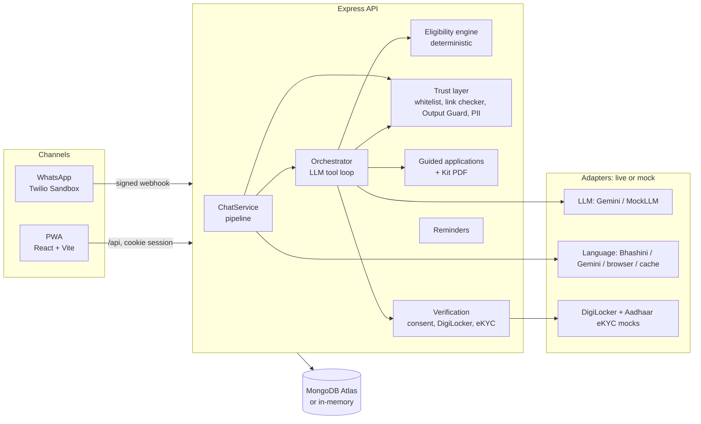

# Architecture

## Chat pipeline (`services/chat.ts`)

1. Voice to text (`ILanguageService.transcribe`; browser Web Speech as client fallback).
2. **PII scrub** (Aadhaar, card-like numbers, phones) before anything is stored or sent to a model.
3. Resolve language: a manual choice locks; otherwise script and detector.
4. **Orchestrate**: the LLM plans up to 5 tool calls (8 zod-validated tools); structured chips bypass the LLM and use
   deterministic reply composition (`compose.ts`).
5. Localise the reply, then **Output Guard** (unlisted links, fees, guarantees, self-harm routing to 112).
6. Chips, TTS (server audio, or `ttsFallback: 'browser'`), persist scrubbed messages, audit entry.

## Why the LLM never decides eligibility

`eligibility/` evaluates per-scheme rule trees against the profile and returns a verdict, matched and failed rules,
and the missing fields to ask next. Each rule carries the profile field's provenance, so the UI can show
Verified vs Estimated. Tests in `eligibility.test.ts` pin the verdicts for fixtures and personas.

## Adapters and resilience

| Adapter | Live | Fallback chain |
|---|---|---|
| LLM | Gemini function calling (`@google/genai`, 12 s timeout) | `ResilientLLM` circuit breaker (3 failures, 45 s) to deterministic MockLLM with offline NLU; Demo badge flips on |
| Speech/translation | Bhashini | Gemini, then script heuristics, cached strings, browser Web Speech |
| DigiLocker / eKYC | not implemented (needs partner access) | mock with persona demo codes |
| WhatsApp | Twilio (signature validated) | mock mode validates against a known test token |
| DB | Mongoose / Atlas | in-memory collection with the same interface |

## Auth and consent

httpOnly cookie `ds_session` (JWT). Chat and profile require recorded consent. Consent decisions, kit links
(24 h) and consent screens use separately-audienced signed tokens. Admin uses `x-admin-passcode`.
`DELETE /api/me` removes profile, messages, applications, trackers, consents and the user record.

## Data model (collections)

`users`, `profiles` (field values + provenance + encrypted where sensitive), `messages` (scrubbed),
`consents`, `applications`, `trackers`, `auditLog`, `schemes`, `documentTypes`.

## WhatsApp specifics

Signature validation, `MessageSid` dedupe, language menu where a number reply records consent, numbered replies map
to the last suggested schemes, voice notes via ASR, media host allowlist, 1500-char message splitting,
"delete my data" confirmation, kit PDF delivered as signed-link media.

## PWA

Per-language font loading, workbox shell precache, stale-while-revalidate for `/api/schemes` and `/api/languages`,
offline banner, low-bandwidth mode (no images, text-first), status badges with icon + text (never colour alone).
